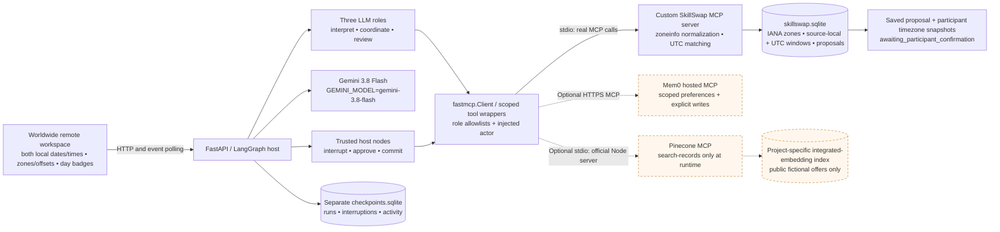
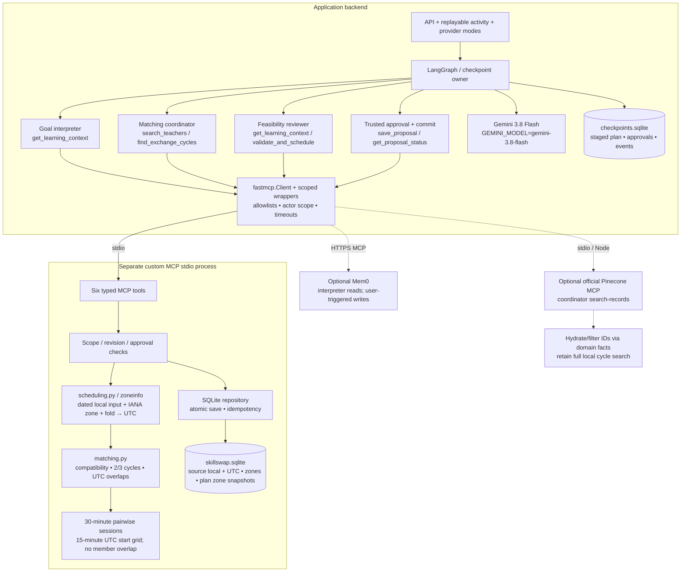
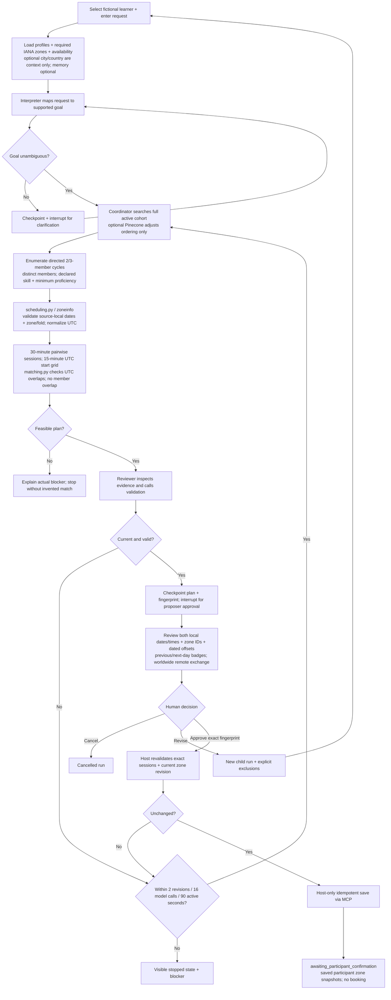
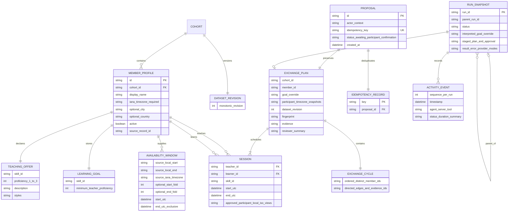

# SkillSwap architecture and diagrams

Architecture prepared October 24, 2026. The October 25 local implementation follows this topology; [validation](../validation-results.md) records local checks and the successful live `gemini-3.5-flash-lite` workflow authorized October 25. Model labels below preserve the original design; the configured default is now `gemini-3.5-flash-lite`. The [design spec](../superpowers/specs/2026-10-24-skillswap-design.md) is authoritative. These diagrams describe the proposed build; they do not establish working integrations. The core is a single-operator demo with fictional profiles. Optional vendor connections require separate authenticated smoke tests.

## System architecture

The backend hosts LangGraph and actual `fastmcp.Client` connections with scoped tool wrappers. Agents discover and invoke domain tools across stdio; they never import domain functions to bypass MCP. Gemini 3.8 Flash is configured through `GEMINI_MODEL=gemini-3.8-flash`; account access and quota remain preflight checks. The domain server exclusively writes domain SQLite, while the graph host owns a separate checkpoint database. Dashed vendor paths are bonuses; both can be enabled independently.

The cohort matches remotely worldwide. Each member supplies a required IANA timezone. Optional self-declared city/country are context only: they never infer timezone, filter by distance, or introduce maps/geocoding/in-person scheduling. The workspace shows each session in both participants' local dates/times, zone IDs, date-specific UTC offsets, and previous/next-day badges.

[Standalone SVG](diagrams/architecture.svg) · [Mermaid source](diagrams/architecture.mmd)



## Components and authority

LLM roles investigate and explain. Deterministic modules enforce skill compatibility, finite cycle search, pairwise scheduling, fingerprints, scope, and idempotency. Only trusted host nodes can call save/status tools. Vendor results cannot override current domain facts. Mem0 writes additionally require explicit user actions.

Within the existing custom MCP process, `scheduling.py` uses `zoneinfo` and validation to normalize dated local availability. It retains source-local dates/times, IANA zone, and `fold` choices for ambiguous endpoints alongside normalized UTC windows. Invalid zones and nonexistent local times are rejected; ambiguous local times require an explicit fold choice. `matching.py` evaluates overlaps in UTC. No additional server or agent is introduced.

[Standalone SVG](diagrams/components.svg) · [Mermaid source](diagrams/components.mmd)



## Matching and approval flow

Every edge is a separate 30-minute teaching session, starting on a 15-minute UTC grid to support quarter-hour offsets. A three-cycle does not need one common three-person slot. Validation prevents a participant's incoming and outgoing sessions from overlapping. Human waiting does not consume the active execution budget. Timezone changes increment the dataset revision, invalidate staged approval, and require revalidation and fresh approval. Saved proposals retain participant timezone snapshots for historical interpretation.

[Mermaid source](diagrams/matching-flow.mmd)



## Proposal sequence and uncertain saves

The host binds approval to the staged fingerprint. Save independently verifies revision and exact times in a transaction. When a save response is uncertain, lookup precedes any retry. An identical saved proposal remains a historical unconfirmed proposal even if the dataset later changes.

[Mermaid source](diagrams/proposal-sequence.mmd)

```mermaid
sequenceDiagram
  actor User as Demo proposer
  participant UI as Workspace
  participant Host as FastAPI / trusted graph host
  participant GraphDB as Checkpoint SQLite
  participant Reviewer as Reviewer LLM
  participant MCP as Scoped backend MCP client
  participant Domain as Custom stdio MCP server
  participant DB as Domain SQLite
  Reviewer->>MCP: validate_and_schedule(cycle, goal)
  MCP->>Domain: Real MCP tool invocation + injected actor
  Domain->>DB: Read profiles, IANA zones, source-local/UTC windows, revision
  Note over Domain,DB: zoneinfo validates local input + fold; matching uses UTC
  Domain-->>MCP: Fingerprinted valid plan
  MCP-->>Reviewer: Adapted tool result
  Host->>GraphDB: Persist staged plan; approval interrupt
  Host-->>UI: Review plan + fingerprint + both local dates/times/zones/offsets
  User->>UI: Approve exact plan
  UI->>Host: Resume(run_id, approve, fingerprint)
  Host->>Host: Serialize resume; verify waiting fingerprint
  Host->>MCP: validate_and_schedule(exact approved sessions)
  MCP->>Domain: Revalidate current facts
  Domain-->>MCP: Current ValidationResult and fingerprinted plan
  MCP-->>Host: Current validation result
  Host->>Host: Compare staged revision and fingerprint with current result
  alt Changed profile/zone revision or invalid sessions
    Host-->>UI: Replan, display changes, require fresh approval
  else Approved plan still current
    Host->>MCP: save_proposal(plan, approval_fingerprint, run_id:fingerprint)
    MCP->>Domain: Host-only write tool
    Domain->>DB: Transaction: reject stale/invalid approval or save proposal + zone snapshots + unique key
    alt Save response received
      Domain-->>MCP: Proposal ID + awaiting_participant_confirmation
      MCP-->>Host: Saved proposal
    else Response lost or timed out
      Host->>MCP: get_proposal_status(idempotency_key)
      MCP->>Domain: Lookup scoped result
      Domain-->>MCP: Existing proposal or explicit not_found
      MCP-->>Host: Scoped lookup result
      Note over Host,Domain: Retry exact idempotent save only after lookup, if needed
    end
    Host->>GraphDB: Persist saved result and activity
    Host-->>UI: Saved proposal + JSON download
    Note over User,UI: Other participants have not confirmed; availability is not reserved
  end
```

## Logical data model

This is a logical relationship view, not a promised SQL migration. Domain entities and graph state belong in different databases. Offer/need evidence, current timezone revision, and UTC times determine eligibility and fingerprints; memory, city/country, and semantic similarity do not. The selected learner's interpreted goal is run-local. Availability preserves the original local input and zone/fold alongside UTC; saved plans preserve participant timezone snapshots rather than relying only on mutable profile zones.

[Mermaid source](diagrams/data-model.mmd)



## Verification boundary

The SVGs use embedded vector elements and system fonts, with accessible titles/descriptions and no external assets. XML parsing and file/link checks can establish structural integrity; they do not establish browser rendering or Mermaid compilation. Runtime transport, credentials, persistence, and model behavior require implementation-time verification described in the spec.

## Implemented Mem0 boundary (October 25 update)

The hosted MCP client injects `skillswap-demo:<cohort_id>:<member_id>` into vendor identity and verifies all project/cohort/member metadata on returned rows. The interpreter first resolves skill/proficiency without any memory content, then requests scoped memory search. Only the coordinator sees retrieved preferences, for soft ranking against canonical profile styles. Domain MCP still validates every cycle and session.

The UI invokes explicit host-only mutations. Additional host-only `get_memory` and `get_memories` calls validate record ownership and populate the panel; these are not agent tools. No bulk/entity administration is registered. Pending operations persist IDs, scope and content hashes in the checkpoint database. Known events are polled; lost responses are reconciled through operation markers and scoped reads. An explicitly acknowledged unknown outcome remains visibly unconfirmed. There is no automatic retry of memory writes. Failed discovery can be retried on a later fresh run; failed reads leave deterministic matching available.
