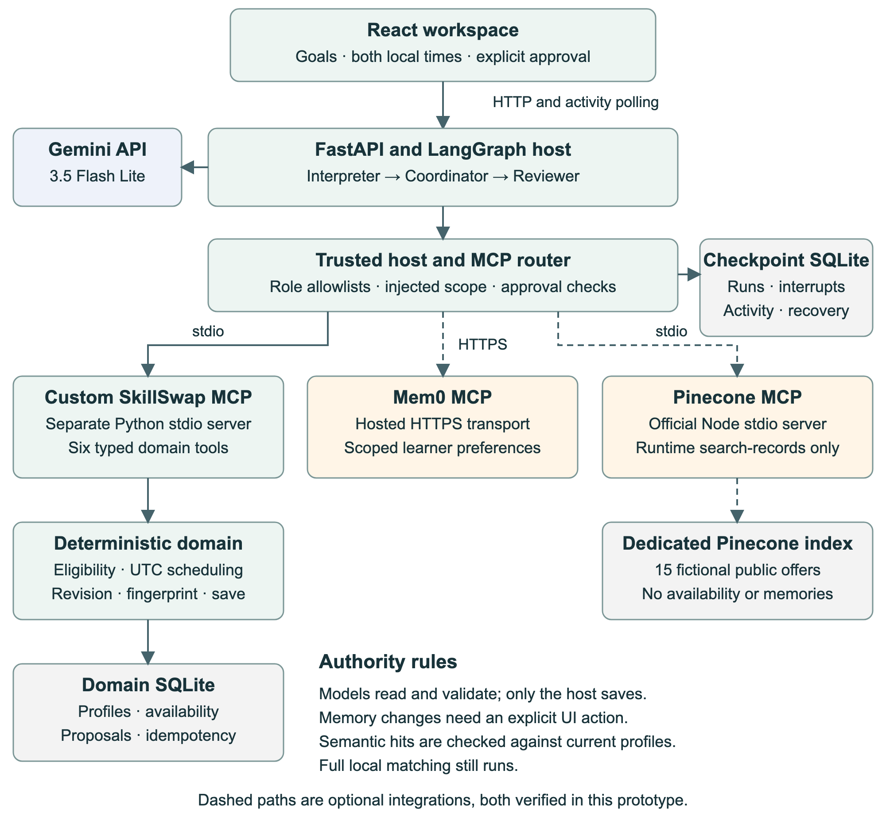
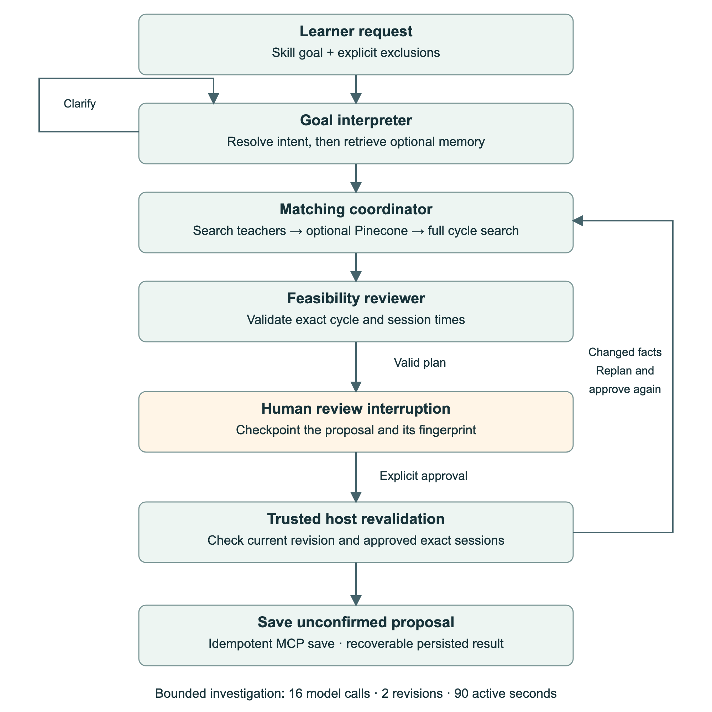
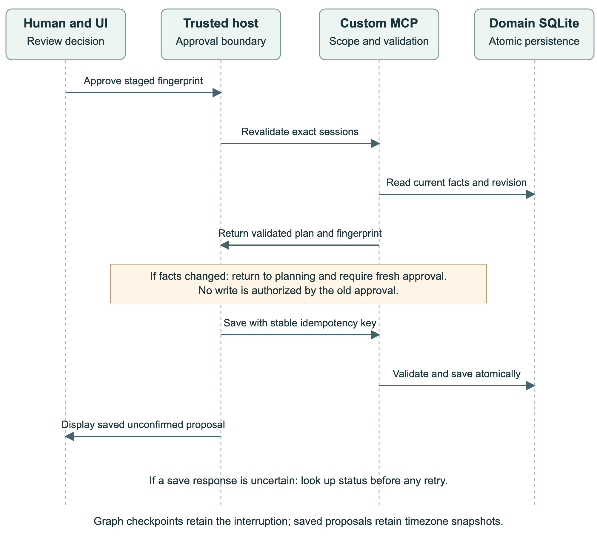

# SkillSwap project documentation

**Author:** Ramesh  
**Course:** The Gen Academy Week 3 — Build Your AI Agent  
**Track:** Code-heavy with LangChain and LangGraph; original use case  
**Prepared:** November 2, 2026  
**Implementation baseline:** `6a86fd7`; recording workflow: `e8e9861`

## Project overview

SkillSwap is a working local web application that helps a global learning cohort exchange teaching time. A learner offers one skill and requests another. The system discovers reciprocal exchanges, checks whether the participants can meet, and presents a proposal for human approval. It supports both direct swaps and circles of three learners.

The prototype combines a React workspace, three Gemini specialist agents orchestrated with LangGraph, a custom MCP server, and persistent SQLite state. Optional Mem0 and Pinecone integrations are also implemented through MCP. The complete core workflow and the integrated bonus workflow have passed live verification. Approval creates an unconfirmed proposal; it does not book a meeting or contact participants.

**Agent one-liner:** SkillSwap helps remote learners turn a learning goal into a reciprocal, timezone-aware teaching proposal in a web workspace, replacing manual profile comparison and scheduling; it investigates and validates through six custom MCP tools, pauses for human approval before saving, and succeeds when a feasible proposal can be reviewed, saved, and recovered without changing the approved participants or times.

The intended prototype target is a reviewable proposal within 90 active execution seconds, excluding human waiting. Recorded successful live examples reached approval in 6.8–16.06 seconds. These are individual observations, not an estimated population success rate or service guarantee.

## User workflow and sample result

1. Select a fictional learner and enter a learning goal. Optionally exclude participants.
2. The interpreter resolves the goal and minimum proficiency, or asks for clarification.
3. The coordinator investigates teachers and reciprocal cycles. Optional memory and semantic discovery inform ordering.
4. The reviewer validates the exact selected cycle and schedule using authoritative tools.
5. Review each session in both participants' local times. Approve, cancel, or revise.
6. The host revalidates the approved fingerprint and saves idempotently. Reload or export the saved proposal.

The main scenario connects Maya in Chicago, Leo in London, and Nina in Bengaluru. Maya teaches Python to Leo; Leo teaches Spanish to Nina; Nina teaches presentation design to Maya. Each meeting lasts 30 minutes. The three learners do not need one shared meeting time.

| Teaching session | Teacher local time | Learner local time |
| --- | --- | --- |
| Maya → Leo, Python | Oct 26, 2026, 13:00–13:30 Chicago, UTC−05:00 | Oct 26, 2026, 18:00–18:30 London, UTC+00:00 |
| Leo → Nina, Spanish | Oct 26, 2026, 13:00–13:30 London, UTC+00:00 | Oct 26, 2026, 18:30–19:00 Bengaluru, UTC+05:30 |
| Nina → Maya, presentation design | Oct 27, 2026, 19:30–20:00 Bengaluru, UTC+05:30 | Oct 27, 2026, 09:00–09:30 Chicago, UTC−05:00 |

These are the original seeded times. In the recorded demo, removing Nina's October 27 window causes the final session to move to October 28 at the same participant-local times. Attempting the old approval triggers a new review requirement. The final status is `awaiting_participant_confirmation`.

## Architecture and agent responsibilities

The request path is React → FastAPI → LangGraph → role-scoped application MCP client → MCP servers. Gemini supplies model reasoning. SQLite stores domain records separately from graph checkpoints and activity. The application owns scope and authorization; the model cannot supply a different actor identity or authorize a save.

| Component | Responsibility | Boundary |
| --- | --- | --- |
| Goal interpreter | Resolve supported skill and proficiency; request clarification; retrieve scoped preferences after resolving hard intent | Memory cannot redefine the goal |
| Matching coordinator | Search teachers and cycles; optionally request semantic discovery; select a returned feasible fingerprint | Cannot invent a plan or save it |
| Feasibility reviewer | Review evidence and validate the exact proposed sessions | Cannot silently change the plan |
| Trusted host | Resume interruptions, verify approval, revalidate, save, reconcile uncertain outcomes | Writes require the approved exact plan |

The agents are three specialist roles, not three separately trained models. The active model is `gemini-3.5-flash-lite`, explicitly selected by the user after `gemini-3.8-flash` returned generation errors. There is no automatic model substitution.

The custom server runs as a separate FastMCP stdio process. The backend uses a real MCP client to discover schemas and invoke tools; these are not ordinary Python functions relabeled as MCP. The six custom tools are `get_learning_context`, `search_teachers`, `find_exchange_cycles`, `validate_and_schedule`, `save_proposal`, and `get_proposal_status`. Save and status operations are reserved for the trusted host.

LangGraph persists clarification and approval interruptions with a SQLite checkpointer. Model execution is bounded by 16 calls, two revisions, and 90 active seconds. A separate 30-second host-only recovery window can retrieve the outcome of an already approved save without adding model reasoning time or changing the approved plan.

## Datasets and state

The project uses a purpose-built synthetic cohort in `data/demo_cohort.json`. It contains 15 fictional learners across Chicago, London, Bengaluru, Sydney, São Paulo, Kathmandu, Dubai, Tokyo, Toronto, Accra, Paris, Rome, Mexico City, Cape Town, and Auckland. It is demonstration data, not scraped user information or a model-training dataset.

Each record includes a stable member ID, cohort, IANA timezone, teaching offer, self-declared proficiency, teaching styles, learning goal, and dated availability. Availability retains the source local date/time and its validated UTC equivalent. The supported skills are Python, SQL, presentation design, Spanish, and Excel automation. The fixed demonstration week is October 26–30, 2026; replaying it later does not imply these are upcoming appointments.

Python `zoneinfo` validates local timestamps, rejects nonexistent DST times, and requires explicit fold selection for ambiguous times. Matching uses UTC intervals, schedules 30-minute sessions on a 15-minute grid, and prevents overlapping sessions for any participant. The interface reconstructs each participant's dated local view, including date-boundary and offset changes.

| Store | Contents | Role |
| --- | --- | --- |
| Domain SQLite | Profiles, availability, revision, proposals, idempotency records | Authoritative eligibility and saved results |
| Checkpoint SQLite | Graph state, interruptions, run metadata, sanitized activity, pending memory operations | Resume and recovery |
| Mem0 through hosted MCP | Explicitly saved learner preferences, scoped by project, cohort, and member | Optional soft ranking |
| Pinecone through official MCP | 15 fictional public teaching offers in the dedicated `skillswap-demo` index | Optional semantic discovery |

Pinecone uses integrated `llama-text-embed-v2` embeddings. Availability and private memory are not embedded. Returned IDs are hydrated against current domain profiles and checked for exclusions, eligibility, and stale offer hashes. Semantic top-k results never restrict the full local cycle search.

## Human control and failure handling

A proposal fingerprint binds approval to specific participants and sessions. The host rechecks the current dataset revision and exact schedule immediately before saving. Changed availability invalidates the staged approval and requires another human decision. Saved proposals retain timezone snapshots for historical interpretation.

Stable idempotency keys prevent duplicate saves. If a save response is lost, the host looks up the outcome before retrying. A saved proposal can therefore be recovered even when the original response was not received. Browser reload and fresh-service restart recovery have separate verification evidence.

Mem0 writes occur only through explicit Remember, Edit, or Forget actions. Pending outcomes remain visible. Known events are checked; unknown outcomes are reconciled using scoped reads rather than blind write retries. A user can acknowledge an unresolved outcome without turning it into a claimed success. Memory is retrieved only after hard intent is resolved.

Provider errors are reported visibly. A bounded retry handles rate limiting; persistent failures stop the affected model workflow without fabricating a proposal. An unavailable Mem0 service permits matching without preferences. Unavailable or unusable Pinecone results produce a labeled full-cohort fallback. The UI distinguishes live providers, degraded states, and controlled test fixtures.

## Use of AI coding tools

Codex was used as the coding assistant to turn the existing planning package into implementation, tests, review fixes, documentation, and recording automation. The human supplied the product requirements and planning package, selected the replacement Gemini model, approved normal prototype usage on the existing paid Pinecone plan, tested the interface, and reported a search failure. Implementation decisions were checked against tests and real service behavior.

The following excerpts are actual user prompts from the project conversation. They document the development direction; they are not the runtime specialist prompts.

> “Let’s build SkillSwap using the existing planning package.”

> “Begin by checking local configuration, runtimes, Gemini access, and a real MCP tool-call round trip.”

> “Implement and verify the complete core workflow before adding bonuses.”

> “Make focused, descriptive commits after each verified milestone.”

> “try using the model: gemini-3.5-flash-lite”

> “The search could not finish. Check the provider status and activity, then try again.”

Subsequent work investigated the failed search through saved checkpoints and sanitized activity, constrained the coordinator to valid returned fingerprints, and verified the same request live. Development also used focused tests for stale approval, lost save responses, DST handling, memory ownership, and concurrent provider results. These descriptions summarize the recorded build process rather than claiming an exact transcript of every assistant instruction.

Runtime prompts are maintained in `backend/src/skillswap/agents.py`. Their responsibilities are to resolve intent, investigate and choose feasible exchanges, and independently review the chosen plan. Tool allowlists and host checks enforce the actual authority boundaries; prompt wording alone is not the enforcement mechanism.

## Iterations and engineering learnings

| Iteration | Observation | Change and lesson |
| --- | --- | --- |
| Local setup and MCP | Initial runtime and provider access were uncertain | Establish compatible local runtimes and a real tool round trip before relying on UI success |
| Gemini model access | Metadata access worked while generation returned 503/504 | Separate discovery from generation verification; change models only with explicit authorization |
| Async persistence | Synchronous SQLite work could block checkpoint progress | Move runtime database work off the event loop |
| Approval and recovery | Data can change after review; a successful write can lose its response | Bind approval to exact content; reconcile uncertain writes with stable keys |
| Search selection | The coordinator returned null despite a feasible proposal | Restrict structured choices to returned fingerprints and bound correction attempts |
| Mem0 | Untrusted preferences could affect hard intent; writes could remain uncertain | Resolve intent first, scope all records, and make pending outcomes explicit |
| Pinecone | Vendor acknowledgements differed from assumed JSON; shared status caused a race | Inspect real response shapes and retain per-call provider outcomes |

The central learning is that reliable agent behavior depends on state and boundaries as much as model reasoning. Timezone correctness belongs in deterministic code. Semantic similarity is a discovery aid, not proof of feasibility. Human approval must authorize the exact action that will execute. A polished interface must accurately communicate failures and uncertainty as well as successful results.

## Verification and observed results

These results were recorded during implementation and the November 2 video capture. The documentation task does not claim that the full application suite was rerun. Detailed evidence is in `docs/validation-results.md`, `docs/build-log.md`, and `docs/demo-script.md`.

| Check | Recorded result | What it establishes |
| --- | --- | --- |
| Backend suite | 70 passed | Domain, MCP, graph, persistence, recovery, and optional-provider boundaries |
| Browser suite | 10 passed | UI workflows with controlled model/vendor responses and real local application layers |
| Static and build checks | Ruff and TypeScript/Vite build passed | Source checks and production UI compilation |
| Live core | 7 model calls; 6.8 active seconds to approval | Real Gemini and custom MCP, followed by approval, save, and fresh-service recovery |
| Live integrated bonuses | 9 calls; 13.07 seconds to approval | Custom MCP, Mem0, and Pinecone in one saved and recovered workflow |
| Live memory comparison | 8 calls per run; 16.06 and 15.85 seconds | A saved preference changed a fresh-session feasible choice from Olivia to Nina |
| Narrated demo | 4 minutes 43.64 seconds; 15 calls including replanning | Live search, stale approval, revised save, reload, export, and provider activity |

The integrated smoke run is `af4edc8f-cafd-4426-8e46-3e6c236ec548`; the recorded demo run is `260e3153-271d-45df-8ee0-0311f067b547`. Successful live samples are not a statistically representative reliability benchmark. Controlled tests are not evidence of vendor uptime. Account-level Gemini free-tier entitlement and remaining quota were not independently verified. Pinecone prototype usage was authorized on an existing paid plan.

## Reproduction and project boundaries

Use Python 3.12, Node 22.12 or later, and `uv`. Follow the root `README.md` to create the virtual environment, install `backend/requirements.lock`, install the editable backend and frontend dependencies, and populate a private `.env` from `.env.example`. Do not overwrite an existing private configuration. Set `GEMINI_MODEL=gemini-3.5-flash-lite` and the Gemini key, then run `bash scripts/dev.sh` and open `http://127.0.0.1:5173`.

Optional providers require their own keys and enable flags. Pinecone additionally requires `npm --prefix integrations/pinecone ci --ignore-scripts` and explicit index seeding for a new environment. The repository documents the live smoke commands and isolated browser-test setup. Start with `scripts/preflight.py --local-only`, then use `--core` for live model/MCP verification.

This is a local, single-operator prototype with one backend worker. It has no production authentication, participant messaging, live calendar booking, recurring-availability editor, arbitrary-length exchange cycles, or public hosting. Availability changes currently use maintenance commands. The fixed synthetic dataset and small cohort make this a demonstration of the workflow, not a production-scale scheduling evaluation.

## Submission assets and final preparation

The repository contains source code, lockfiles, tests, a reproducible setup guide, architecture diagrams, validation notes, and recording scripts. The local video is `storage/demo-video/SkillSwap-demo.mp4`, with companion subtitles. It uses synthetic narration and fictional data; a personal voice recording can replace the narration.

The course handout requests a Google Doc, a video of five minutes or less, and a GitHub link. This report is supplied as an editable document for import into Google Docs and as repository Markdown. No Google Doc, video upload, public repository, or submission form has been published by this documentation task. Shared URLs must be added after those actions are completed.

The current video demonstrates the application but does not explicitly describe AI-assisted coding. When recording the personal narration, replace part of the introduction with: “I built SkillSwap with Codex from an existing design and implementation plan. I used it for the MCP server, LangGraph workflow, React interface, tests, and debugging. I verified the result with live provider calls and automated checks.” Keep the final edited recording under five minutes.

For reviewer navigation, use `README.md` for setup, `docs/skillswap/architecture.md` for architecture, `docs/validation-results.md` for evidence, `docs/build-log.md` for iterations, and `docs/demo-script.md` for the recording walkthrough. Historical planning diagrams retain the originally requested Gemini model; the implemented runtime and this submission use the explicitly authorized Flash Lite model.

<!-- pagebreak -->

## System architecture diagram

This diagram shows the implemented application and its service boundaries. The three specialist roles use Gemini `gemini-3.5-flash-lite`. The host applies scope and approval policy before real MCP calls cross process or network boundaries.

The custom server owns domain operations. Graph checkpoints are separate from profiles and proposals. Mem0 and Pinecone enrich the workflow without becoming authoritative sources for eligibility or availability.

<!-- pagebreak -->

## Agent workflow diagram

The workflow combines model reasoning with deterministic validation. Clarification and human review are durable interruptions. Optional memory is retrieved after hard intent is resolved; semantic search does not limit the full local search.

Cancellation stops the run. A requested revision starts a child run with explicit exclusions. Review failures may trigger bounded replanning; exhausted limits or unavailable model calls produce a visible stopped state. Changed facts require a new review and approval, rather than reusing consent for different times.

<!-- pagebreak -->

## Approval and save sequence diagram

This sequence expands the most important write boundary. Approval identifies the exact staged plan. The host and custom server validate it against current facts before an atomic, idempotent save.

The arrows summarize logical request and result paths; MCP responses return through the application client and host. If a response is lost, status lookup precedes retry. A successful save records an unconfirmed proposal and approved timezone snapshots; it does not book sessions or send invitations.
